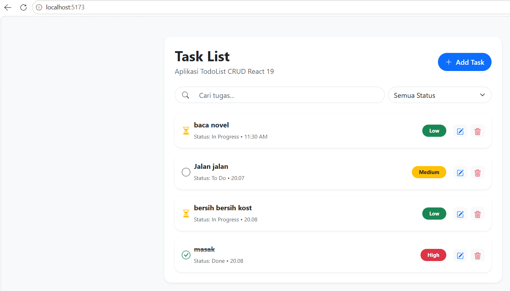

# Aplikasi TodoList CRUD React 19

Aplikasi web TodoList interaktif yang dibangun menggunakan React 19, Vite, dan React-Bootstrap untuk memenuhi tugas praktikum.

## Fitur Utama
- Create, Read, Update, Delete (CRUD) tugas harian secara dinamis.
- Badge warna prioritas (High, Medium, Low).
- Indikator status (To Do, In Progress, Done) interaktif yang dapat diklik.
- Fitur pencarian tugas dan filter berdasarkan status.
- Pencatatan waktu pembuatan tugas (*timestamp*).

## Tampilan Antarmuka (Screenshot)
